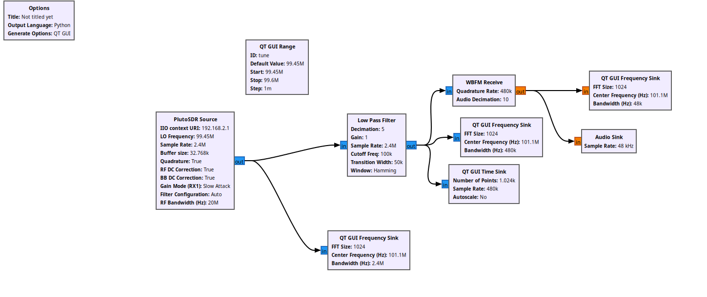

# Архитектура Adalm Pluto SDR. GNU Radio. Построение радио-приёмника

Была установленна программа gnu radio и нужные библиотеки.

GNURadio - это инструмент с открытым исходным кодом для разработки программного обеспечения в сфере программно-определяемого радио [[1](https://app.notion.com/doc/18-gnu-radio-postroenie-radio-priyomnika-jK0AORyb7H)]. Инструмент позволяет при помощи “строительных блоков” создать конфигурацию радиоустройства, не написав ни одной строчки кода, и запустить программу непосредственно с использованием модуля SDR (программно-определяемое радио), например Adalm-Pluto, LimeSDR, и др.

sudo add-apt-repository ppa:gnuradio/gnuradio-releases
sudo apt-get update
sudo apt-get install gnuradio python3-packaging

Итоговая схема выглядит следующим образом:

Цель на следующее занятие: Понять почему схема не работает и принимается только шум.