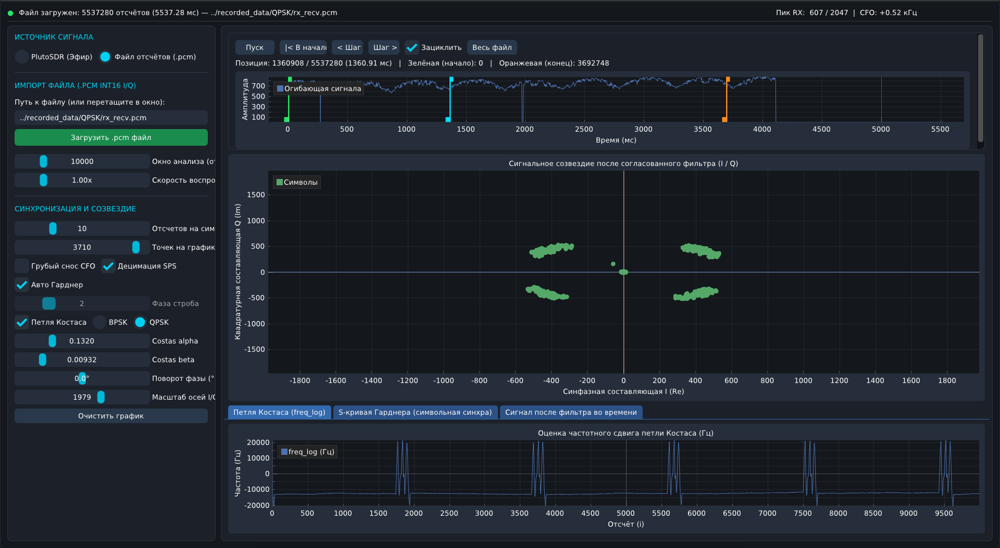

# Приемник. Символьная синхронизация.Добавление визуального интерфейса ImGUI для визуализации данных с AdalmPluto.

Был реализован алгоритм цикла Костеса для частотной синхронизации.

Нужно пересмотреть порядок алгоритмов. Текущий порядок:

свертка → частотная синхронизация → символьная синхронизация.

```
N = len(samples)
phase = 0
freq = 0
# These next two params is what to adjust, to make the feedback loop faster or slower (which impacts stability)
alpha = 0.132
beta = 0.00932
out = np.zeros(N, dtype=np.complex64)
freq_log = []
for i in range(N):
    out[i] = samples[i] * np.exp(-1j*phase) # adjust the input sample by the inverse of the estimated phase offset
    error = np.real(out[i]) * np.imag(out[i]) # This is the error formula for 2nd order Costas Loop (e.g. for BPSK)

    # Advance the loop (recalc phase and freq offset)
    freq += (beta * error)
    freq_log.append(freq * fs / (2*np.pi)) # convert from angular velocity to Hz for logging
    phase += freq + (alpha * error)

    # Optional: Adjust phase so its always between 0 and 2pi, recall that phase wraps around every 2pi
    while phase >= 2*np.pi:
        phase -= 2*np.pi
    while phase < 0:
        phase += 2*np.pi

# Plot freq over time to see how long it takes to hit the right offset
plt.plot(freq_log,'.-')
plt.show()
```

