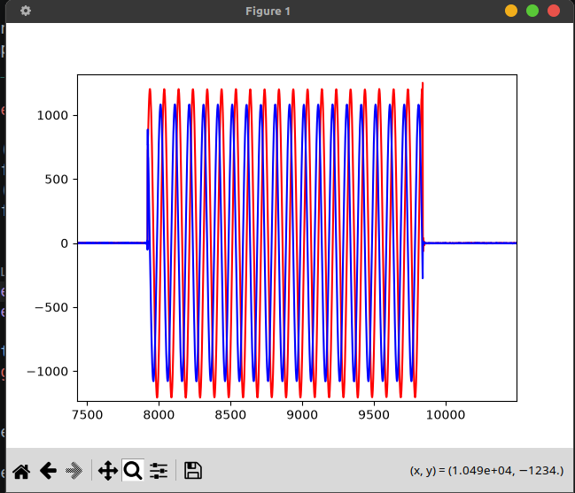

# Знакомство с библиотеками Soapy SDR, Libio для работы с Adalm Pluto SDR. Инициализация SDR-устройства. Работа с буфером: получение цифровых IQ-отсчетов.

Были установленны необходимые библиотеки 

**SoapySDR**

```
sudo apt-get install python3-pip python3-setuptools
sudo apt-get install cmake g++ libpython3-dev python3-numpy swig python3-matplotlib

git clone --branch soapy-sdr-0.8.1 https://github.com/TelecomDep/SoapySDR.git

cd SoapySDR
mkdir build && cd build

cmake ../

make -j\`nproc\` # nproc - количество потоков, например make -j16
sudo make install
sudo ldconfig
```

**Libiio**

```
sudo apt-get install libxml2 libxml2-dev bison flex libcdk5-dev cmake
sudo apt-get install libusb-1.0-0-dev libaio-dev pkg-config
sudo apt install libavahi-common-dev libavahi-client-dev

git clone --branch v0.24 https://github.com/TelecomDep/libiio.git

cd libiio
mkdir build && cd build
cmake ../
make -j`nproc` # nproc - количество потоков, например make -j16
sudo make install
```

**LibAD9361**

```
git clone --branch v0.3 https://github.com/TelecomDep/libad9361-iio.git
cd libad9361-iio

mkdir build && cd build

cmake ../

make -j\`nproc\` # nproc - количество потоков, например make -j16
sudo make install
sudo ldconfig
```

**SoapyPlutoSDR**

```
git clone --branch sdr_gadget_timestamping https://github.com/TelecomDep/SoapyPlutoSDR.git
cd SoapyPlutoSDR

mkdir build && cd build

cmake ../

make -j\`nproc\` # nproc - количество потоков, например make -j16
sudo make install
sudo ldconfig
```

Был проанализирован и запущен пример создан cmakelist Передача отсчетов прошла успешно. В качестве дополнительного задание нужно было передать синусоиду.

выполнено это задание было за счет изменения цикла наполнения буфера.

```c
 double tone_freq = 10e3;
    double amplitude = 20000.0;
    for (size_t i = 0; i < tx_mtu; i++)
    {
        double t = (double)i / sample_rate;
        
        tx_buff[2 * i]     = (int16_t)(amplitude * cos(2.0 * M_PI * tone_freq * t));

        tx_buff[2 * i +1] = (int16_t)(amplitude * sin(2.0 * M_PI * tone_freq * t));
    }

```

Передача прошла успешно.

Принятый сигнал:

