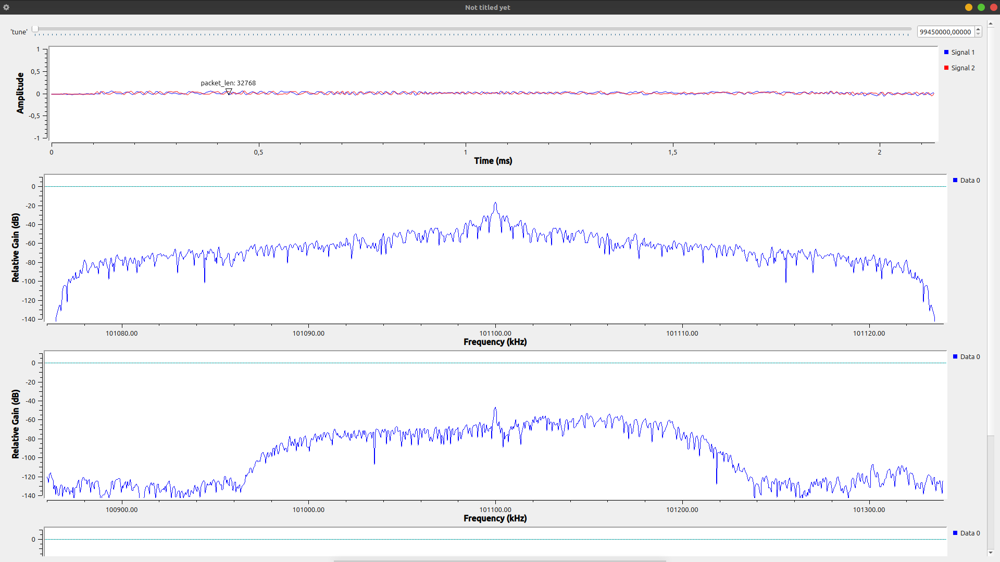

# Знакомство с библиотеками Soapy SDR, Libio для работы с Adalm Pluto SDR. Инициализация SDR-устройства. Работа с буфером: получение цифровых IQ-отсчетов.

Была проведена работа над ошибками и начал изучение теории для приема fm радио сигнала.

Совершен прием радио сигнала в среде gnu radio

