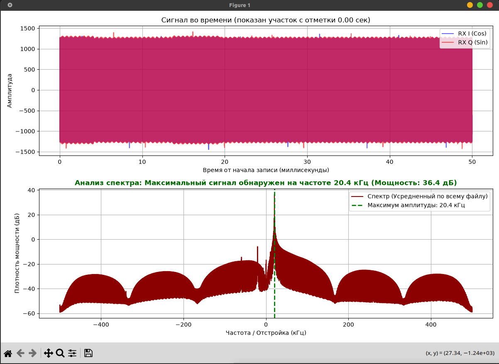

# Работа с буфером: получение цифровых IQ-отсчетов. Прием-передача сэмплов на 2 SDR.

Программа проверяет двустороннюю передачу синусоидальных сигналов между двумя платами ADALM-Pluto \

### Что изменилось по сравнению с исходным примером

- **Добавлены два режима запуска — `tx` и `rx`**, а URI платы передается аргументом командной строки.
- **Настроен раздельный частотный план:** режим `tx` передает на 800 МГц и принимает на 840 МГц; режим `rx` передает на 840 МГц и принимает на 800 МГц.
- **Вместо одного заранее заполненного буфера сигнал формируется постоянно:** `tx` передает тон 10 кГц, `rx` — 20 кГц.
- **Передача выполняется для каждого блока**, а не один раз при `buffers_read == 2`. Время передачи по-прежнему назначается на 4 мс позже временной метки принятого блока.
- **Добавлена запись двух отдельных файлов:** `tx_sent.pcm` / `rx_sent.pcm` содержат отправленные сэмплы, а `tx_recv.pcm` / `rx_recv.pcm` — принятые. Файлы открываются в бинарном режиме и перезаписываются при запуске.
- **Вместо десяти итераций программа работает до Ctrl+C.** Обработчик сигнала позволяет завершить цикл и корректно закрыть файлы, потоки и устройство. Перед началом записи также пропускаются первые 128 принятых буферов.
- **Исправлена передача номера канала в `setGain`:** передается индекс `channels[0]`, а не массив каналов.
- **Учитывается 12-битное выравнивание Pluto:** амплитуда задана как 2000 (при максимуме 2047), значения перед передачей сдвигаются на 4 бита; отправляемые отсчеты сохраняются без этого выравнивающего сдвига.

### Итог

Исходный пример был преобразован из короткого теста с одной частотой и ограниченным числом чтений в длительный двусторонний тест. Теперь можно проверить наличие сигнала от второй платы по уровню и частоте, а также сохранить отправленные и принятые I/Q-данные для последующего анализа.

