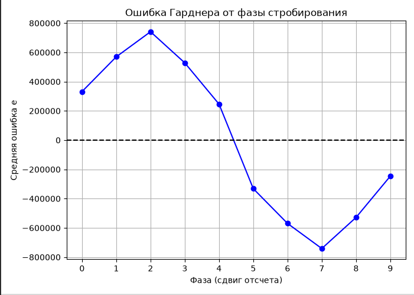
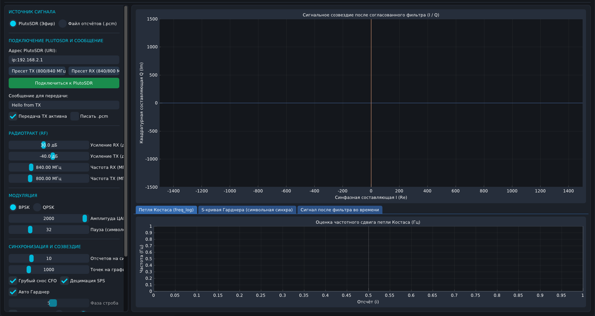
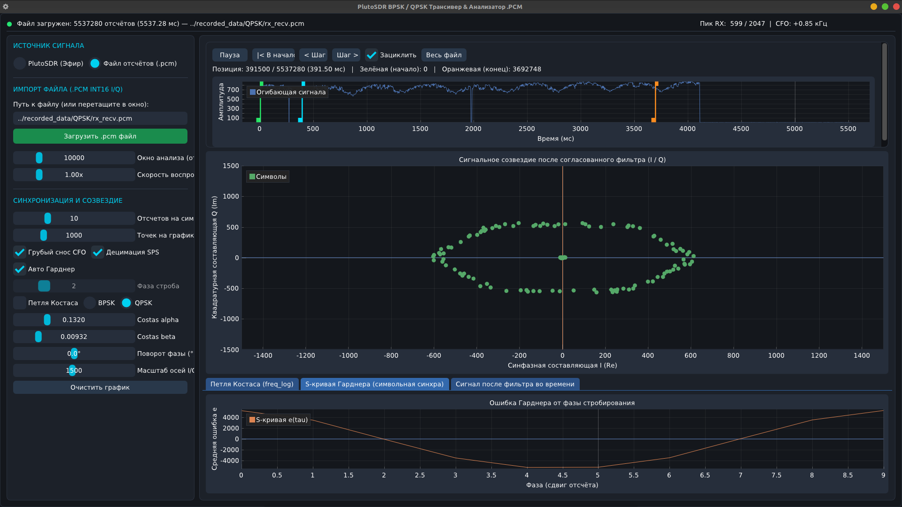

# Приемник. Символьная синхронизация.Добавление визуального интерфейса ImGUI для визуализации данных с AdalmPluto.

Была реализована функция подсчета ошибки методом Гарднера для последующей реализации символьной синхронизации.

В коде программы приемо-передатчика были реализованы: свертка с последующей символьной синхронизацией, графический интерфейс с возможностью просмотра уже записных в файл отсчетов с таймлайном позволяющим выбирать конкретный момент передачи для последующего анализа и вторая вкладка для визуализации принимаемых отсчетов в реальном времени. 

