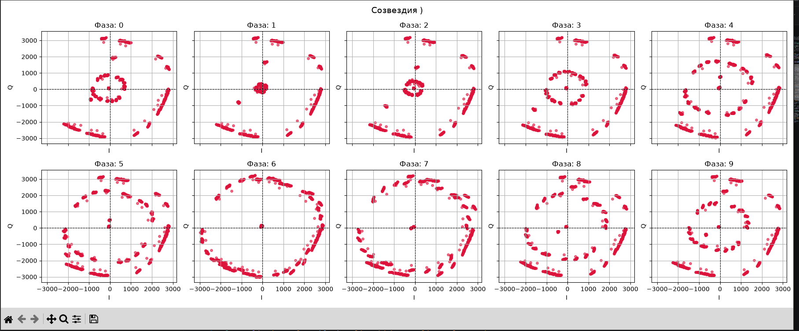
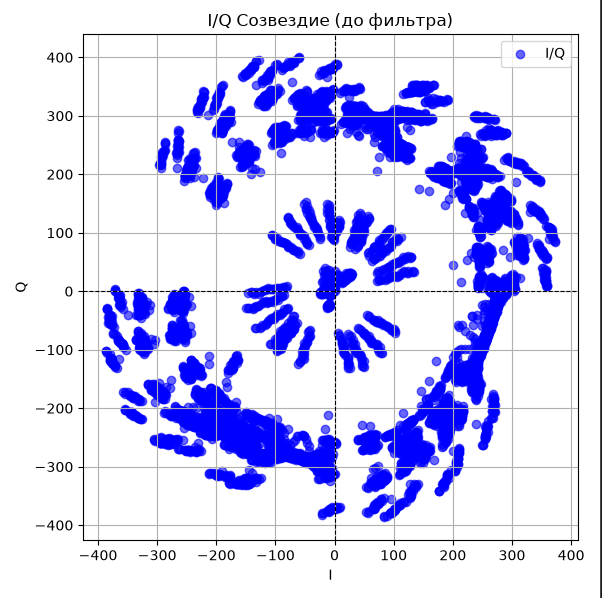
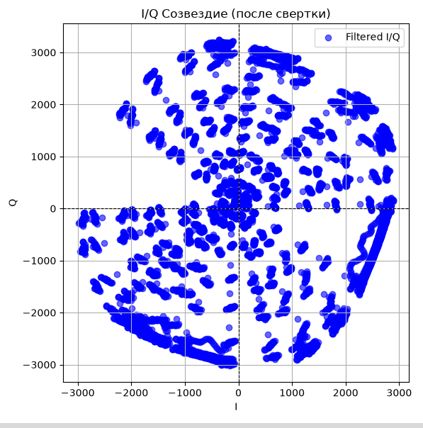

# Приемник. Выбор символьных отсчётов и их визуализация после согласованного фильтра

Была реализована следующая последовательность действий для передатчика:

биты → модуляция → upsampling →свертка → передача

для приемника

отсчеты → демодуляция → свертка

после свертка происходит выборка с разными фазами по импульсной характеристике из свертки, чтобы определить смещение сигнала и  произвести синхронизацию, в будущем правильного декодирования информации.

в этом случае для BPSK модуляции лучшим вариантом выглядит смещение на 6 отсчетов

